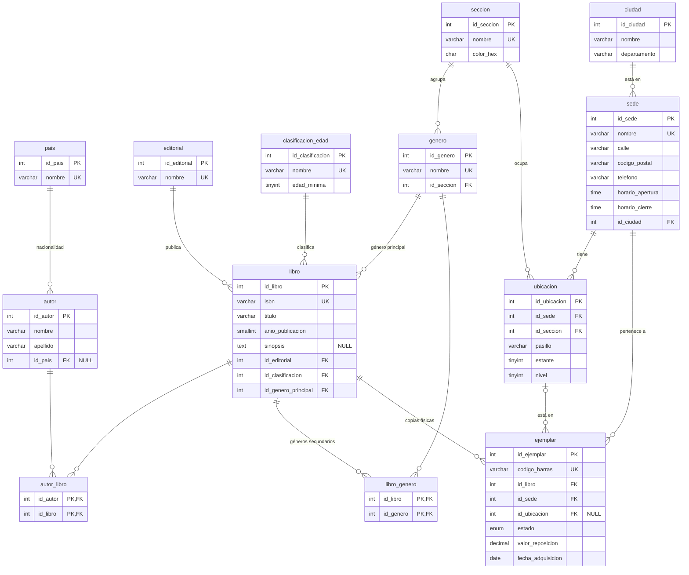

# Modelo de datos — bibliotecaNext

> Derivado de [reglas-de-negocio.md](reglas-de-negocio.md). Cada tabla indica de qué reglas sale.
> Convenciones: C-01 a C-05. Se construye por bloques; los tipos son los que tendrá `db/schema.sql` (MySQL 8).

## Bloque 1 — Catálogo y ubicación

### De dónde sale cada tabla

| Tabla | Reglas | Notas de diseño |
|---|---|---|
| `pais` | C-03 | Solo para la nacionalidad del autor. |
| `ciudad` | C-03, RN-42 | `UNIQUE(nombre, departamento)`: hay municipios con el mismo nombre en departamentos distintos. |
| `editorial` | C-02 | Catálogo editable. |
| `autor`, `autor_libro` | Caso BD2 | N:M. `id_pais` admite NULL: se puede no conocer la nacionalidad. |
| `clasificacion_edad` | RN-46 | `edad_minima` es lo que permite **calcular** si un lector puede acceder a un título. |
| `seccion` | RN-18 | De toda la red; el color es de la sección. `color_hex` con `CHECK` de formato `#RRGGBB`. |
| `genero` | RN-19 | `id_seccion NOT NULL`: cada género pertenece a una sola sección; así se sabe dónde va un libro. |
| `libro` | RN-19, RN-46 | `id_genero_principal` decide sección y color. `isbn` único. |
| `libro_genero` | RN-19 | Solo géneros **secundarios**. Que no repita el principal no se puede expresar con un `CHECK` (involucra otra tabla): se valida en la capa de lógica. |
| `sede` | D-01 | Antes `Biblioteca` en BD2 (C-05). |
| `ubicacion` | RN-17, RN-18 | Una fila = un nivel de un estante. `UNIQUE(id_sede, pasillo, estante, nivel)`. `UNIQUE(id_ubicacion, id_sede)` para la FK compuesta de `ejemplar`. |
| `ejemplar` | RN-06, RN-13, RN-20, RN-22, RN-23 | Ver restricciones abajo. |

### Restricciones de `ejemplar`

1. **La ubicación debe ser de la misma sede que el ejemplar.** Se garantiza con una FK compuesta:
   `FOREIGN KEY (id_ubicacion, id_sede) REFERENCES ubicacion (id_ubicacion, id_sede)`.
   Si `id_ubicacion` es NULL, la FK no se evalúa (por ubicar o en tránsito).
2. **Coherencia entre estado y ubicación** (RN-20, RN-22):
   - `por_ubicar` y `en_transito` → `id_ubicacion IS NULL`.
   - `disponible` → `id_ubicacion IS NOT NULL`.
   - Se expresa con `CHECK`. Limitación de MySQL a verificar al escribir el SQL: una columna usada en un `CHECK`
     no puede tener acciones `ON DELETE/UPDATE` en su FK, así que esa FK queda `RESTRICT` (que es lo que queremos:
     no se borra un estante con libros).
3. `estado` es ENUM (C-02) con los 8 valores de RN-22 y se actualiza en transacción (RN-23).
4. `id_sede` cambia al devolver en otra sede (RN-13) o al recibir un traslado (RN-16).

### Datos que **no** se guardan en este bloque

- **Fecha de la última auditoría de un estante** (RN-21): se calculará como `MAX(fecha)` de la tabla de auditorías
  (bloque de operación de sede), en vez de una columna que habría que mantener.
- **Disponibilidad por sede** (RN-08): `COUNT(*)` de ejemplares `disponible` agrupado por sede.
