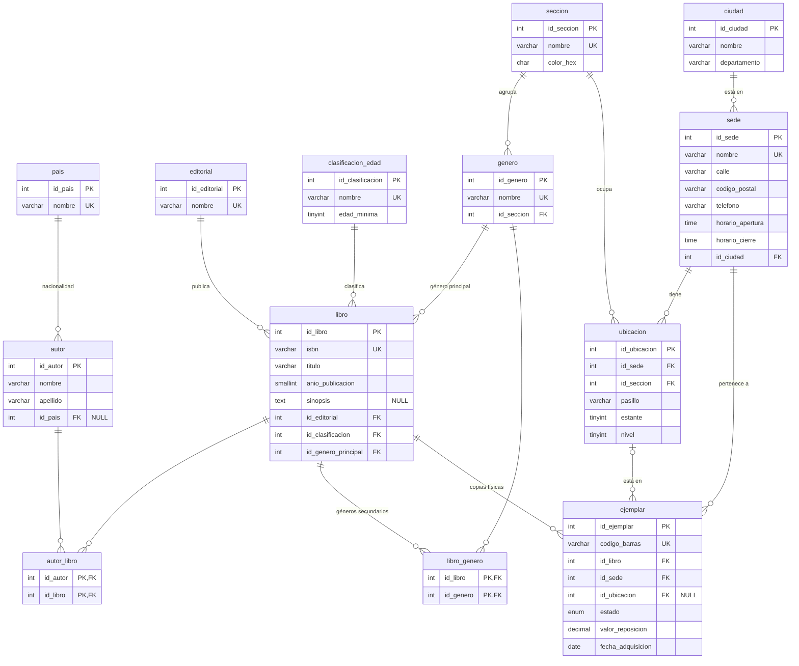
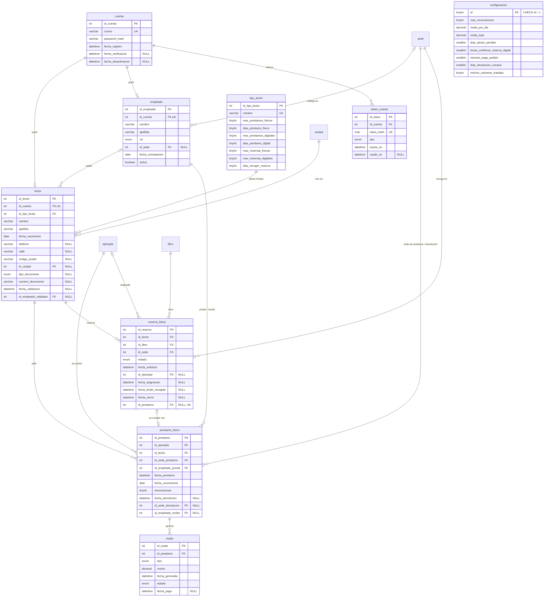
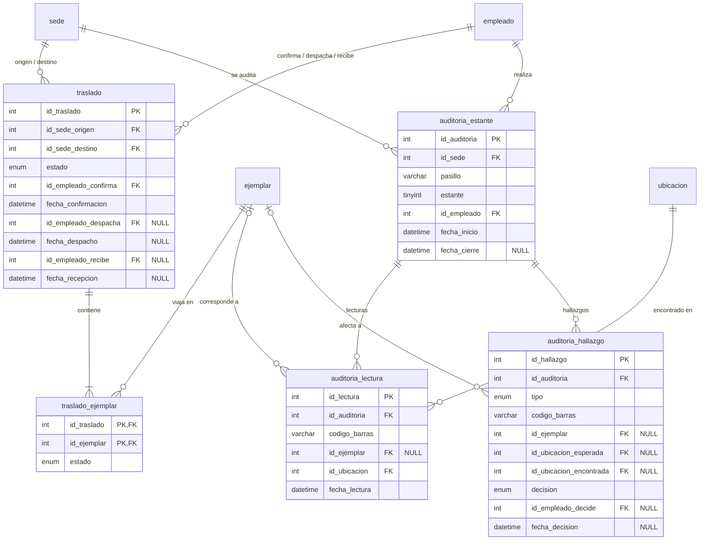

# Modelo de datos — bibliotecaNext

> Derivado de [reglas-de-negocio.md](reglas-de-negocio.md). Cada tabla indica de qué reglas sale.
> Convenciones: C-01 a C-05. Se construye por bloques; los tipos son los que tendrá `db/schema.sql` (MySQL 8).

## Bloque 1 — Catálogo y ubicación

### De dónde sale cada tabla

| Tabla | Reglas | Notas de diseño |
|---|---|---|
| `pais` | C-03 | Solo para la nacionalidad del autor. |
| `ciudad` | C-03, RN-42 | `UNIQUE(nombre, departamento)`: hay municipios con el mismo nombre en departamentos distintos. |
| `editorial` | C-02 | Catálogo editable. |
| `autor`, `autor_libro` | Caso BD2 | N:M. `id_pais` admite NULL: se puede no conocer la nacionalidad. |
| `clasificacion_edad` | RN-46 | `edad_minima` es lo que permite **calcular** si un lector puede acceder a un título. |
| `seccion` | RN-18 | De toda la red; el color es de la sección. `color_hex` con `CHECK` de formato `#RRGGBB`. |
| `genero` | RN-19 | `id_seccion NOT NULL`: cada género pertenece a una sola sección; así se sabe dónde va un libro. |
| `libro` | RN-19, RN-46 | `id_genero_principal` decide sección y color. `isbn` único. |
| `libro_genero` | RN-19 | Solo géneros **secundarios**. Que no repita el principal no se puede expresar con un `CHECK` (involucra otra tabla): se valida en la capa de lógica. |
| `sede` | D-01 | Antes `Biblioteca` en BD2 (C-05). |
| `ubicacion` | RN-17, RN-18 | Una fila = un nivel de un estante. `UNIQUE(id_sede, pasillo, estante, nivel)`. `UNIQUE(id_ubicacion, id_sede)` para la FK compuesta de `ejemplar`. |
| `ejemplar` | RN-06, RN-13, RN-20, RN-22, RN-23 | Ver restricciones abajo. |

### Restricciones de `ejemplar`

1. **La ubicación debe ser de la misma sede que el ejemplar.** Se garantiza con una FK compuesta:
   `FOREIGN KEY (id_ubicacion, id_sede) REFERENCES ubicacion (id_ubicacion, id_sede)`.
   Si `id_ubicacion` es NULL, la FK no se evalúa (por ubicar o en tránsito).
2. **Coherencia entre estado y ubicación** (RN-20, RN-22):
   - `por_ubicar` y `en_transito` → `id_ubicacion IS NULL`.
   - `disponible` → `id_ubicacion IS NOT NULL`.
   - Se expresa con `CHECK`. Limitación de MySQL a verificar al escribir el SQL: una columna usada en un `CHECK`
     no puede tener acciones `ON DELETE/UPDATE` en su FK, así que esa FK queda `RESTRICT` (que es lo que queremos:
     no se borra un estante con libros).
3. `estado` es ENUM (C-02) con los 8 valores de RN-22 y se actualiza en transacción (RN-23).
4. `id_sede` cambia al devolver en otra sede (RN-13) o al recibir un traslado (RN-16).

### Datos que **no** se guardan en este bloque

- **Fecha de la última auditoría de un estante** (RN-21): se calculará como `MAX(fecha)` de la tabla de auditorías
  (bloque de operación de sede), en vez de una columna que habría que mantener.
- **Disponibilidad por sede** (RN-08): `COUNT(*)` de ejemplares `disponible` agrupado por sede.

## Bloque 2 — Cuentas, lectores, préstamos físicos, reservas y multas

### De dónde sale cada tabla

| Tabla | Reglas | Notas de diseño |
|---|---|---|
| `configuracion` | C-04, valores iniciales, RN-14 | **Una sola fila** con columnas tipadas (`CHECK (id = 1)`), en vez de clave-valor: cada valor tiene su tipo y no se puede escribir mal el nombre. |
| `tipo_lector` | RN-02, RN-12, RN-26, RN-45 | Todos los límites por tipo de lector. |
| `cuenta` | RN-01, RN-31 | Sin columna de estado: se deduce de `fecha_verificacion`, `lector.fecha_validacion` y `fecha_desactivacion` (RN-01). |
| `token_cuenta` | RN-32 | Se guarda el **hash** del token, no el token: si alguien lee la BD, no puede usar los enlaces. `tipo`: `verificar_correo`, `recuperar_contrasena`. Un solo uso (`usado_en`) y vencimiento (`expira_en`). |
| `lector` | D-03, RN-02, RN-46 | Documento y validación quedan NULL hasta la validación en mostrador. `UNIQUE(tipo_documento, numero_documento)`. El carné de BD2 desaparece: lo identifica la cuenta y, tras validar, el documento. |
| `empleado` | RN-33, RN-34 | `rol` ENUM: `bibliotecario`, `coordinador`, `admin_red`. `CHECK`: `admin_red` ⇔ `id_sede IS NULL`. `activo` reemplaza a `EstadoEmpleado` de BD2. |
| `prestamo_fisico` | RN-02 a RN-05, RN-13, RN-34 | Estado **calculado**: devuelto / vencido / activo según las fechas. `renovaciones` como contador (RN-04); la fecha de vencimiento se corre al renovar. |
| `multa` | RN-05, RN-06 | `tipo`: `retraso`, `reposicion`. `UNIQUE(id_prestamo, tipo)`: un préstamo no genera dos multas del mismo tipo. `estado`: `pendiente`, `pagada`, `anulada`. |
| `reserva_fisica` | RN-07 a RN-12 | La cola es `ORDER BY fecha_solicitud, id_reserva`. `id_prestamo` enlaza la reserva cumplida con el préstamo que la cumplió. |

### Restricciones que protege la base de datos

1. **Un ejemplar no puede tener dos préstamos abiertos.** Columna generada
   `ejemplar_abierto AS (IF(fecha_devolucion IS NULL, id_ejemplar, NULL))` con `UNIQUE`.
   MySQL permite varios NULL en un índice único, así que solo choca entre préstamos abiertos.
   Es una **segunda barrera**, además del candado del estado del ejemplar (RN-23).
2. **Un lector no puede tener dos reservas vivas de la misma obra.** El mismo truco:
   columna generada con `id_libro` cuando el estado es `activa` o `asignada`, y `UNIQUE(id_lector, esa columna)`.
3. **Coherencia dentro de la fila** con `CHECK`:
   - préstamo: `fecha_devolucion`, `id_sede_devolucion` e `id_empleado_recibe` son todos NULL o todos no NULL;
     `fecha_vencimiento >= DATE(fecha_prestamo)`; `renovaciones >= 0`.
   - reserva: `asignada` ⇒ `id_ejemplar` y `fecha_limite_recogida` no NULL; `cumplida` ⇒ `id_prestamo` no NULL.
   - multa: `pagada` ⇔ `fecha_pago IS NOT NULL`; `monto > 0`.
4. **Lo que no puede proteger la BD** (involucra otras tablas o reglas con valores de configuración): límites del tipo
   de lector, bloqueo (RN-03, RN-43), edad (RN-46), renovación sin reservas (RN-04). Se validan en `lib/actions`, dentro
   de la transacción.

### Datos que no se guardan en este bloque

- **Estado del préstamo** (activo, vencido, devuelto): se deduce de las fechas (decisión heredada de BD2).
- **Bloqueo del lector** (RN-03): hay multas `pendiente` o préstamos abiertos con `fecha_vencimiento` pasada.
- **Edad del lector** (RN-46): `TIMESTAMPDIFF(YEAR, fecha_nacimiento, CURDATE())`.
- **Posición en la cola** de una reserva: se cuenta, no se guarda.

### Decisiones tomadas al derivar el bloque

- Estado de la cuenta deducido de fechas, sin ENUM → RN-01 actualizada.
- Vencimiento perezoso de reservas y pedidos → RN-48.
- Declaración de ejemplar perdido por un empleado, desde una lista calculada → RN-49.

## Bloque 3 — Operación de sede: traslados y auditorías

### De dónde sale cada tabla

| Tabla | Reglas | Notas de diseño |
|---|---|---|
| `traslado` | RN-14 a RN-16, RN-50 | Cabecera del lote. `estado`: `pendiente`, `en_transito`, `recibido`, `cancelado`. `CHECK (id_sede_origen <> id_sede_destino)` y coherencia estado ↔ fechas (despachado ⇒ `fecha_despacho` no NULL, etc.). |
| `traslado_ejemplar` | RN-51, RN-52 | Detalle. `estado`: `incluido`, `cancelado` (no estaba disponible al despachar). |
| `auditoria_estante` | RN-21, RN-53 | Un estante = `(id_sede, pasillo, estante)`, todos sus niveles. En curso ⇔ `fecha_cierre IS NULL` (deducido, sin ENUM). |
| `auditoria_lectura` | RN-53 | Guarda el **código leído** aunque no exista (`id_ejemplar` NULL). `UNIQUE(id_auditoria, codigo_barras)`: leer dos veces el mismo código no duplica. `id_ubicacion` = nivel donde se encontró. |
| `auditoria_hallazgo` | RN-53 | `tipo`: `faltante`, `mal_ubicado`, `estado_incoherente`, `desconocido`. `decision`: `pendiente`, `aplicada`, `descartada`. |

### Conceptos del bloque

- **Cabecera/detalle** (`traslado` + `traslado_ejemplar`): el mismo patrón que tendrán los pedidos. La cabecera guarda lo
  común al envío; el detalle, lo de cada ítem.
- **Congelar un cálculo al cerrar**: los hallazgos se podrían recalcular siempre, pero los ejemplares se siguen moviendo
  y el resultado de hoy no sería el de la auditoría. Al cerrarla, el cálculo se guarda como **hecho histórico**.
  Es la misma razón por la que el pedido guarda el precio del momento (RN-39).
- **Lo que no protege la BD**: que un ejemplar no esté en dos traslados abiertos a la vez (el estado vive en la
  cabecera, otra tabla). Lo cubren el candado de RN-51 y la validación en `lib/actions`.

### Fuera de alcance (anotado)

- Recepción parcial de un lote (llega la caja con un libro menos): se detectaría en una auditoría posterior.
