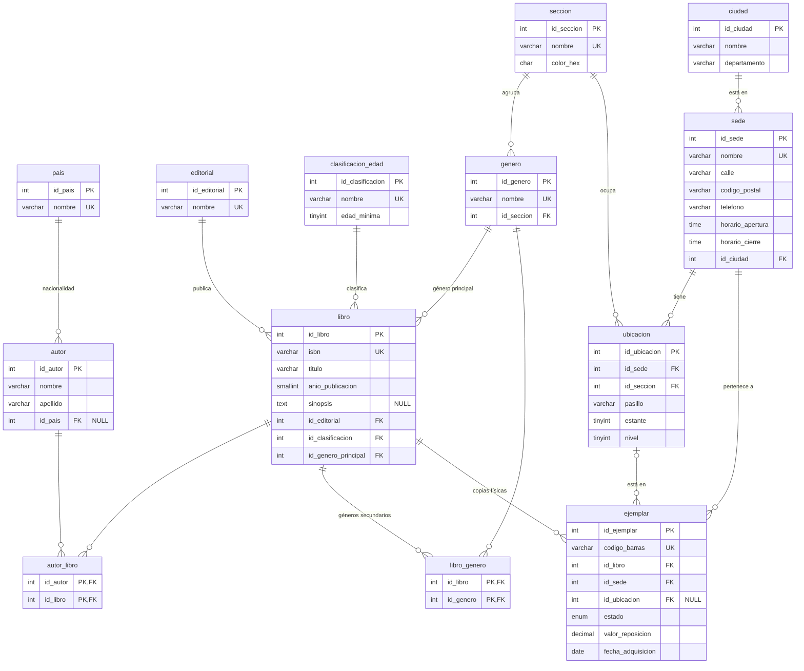
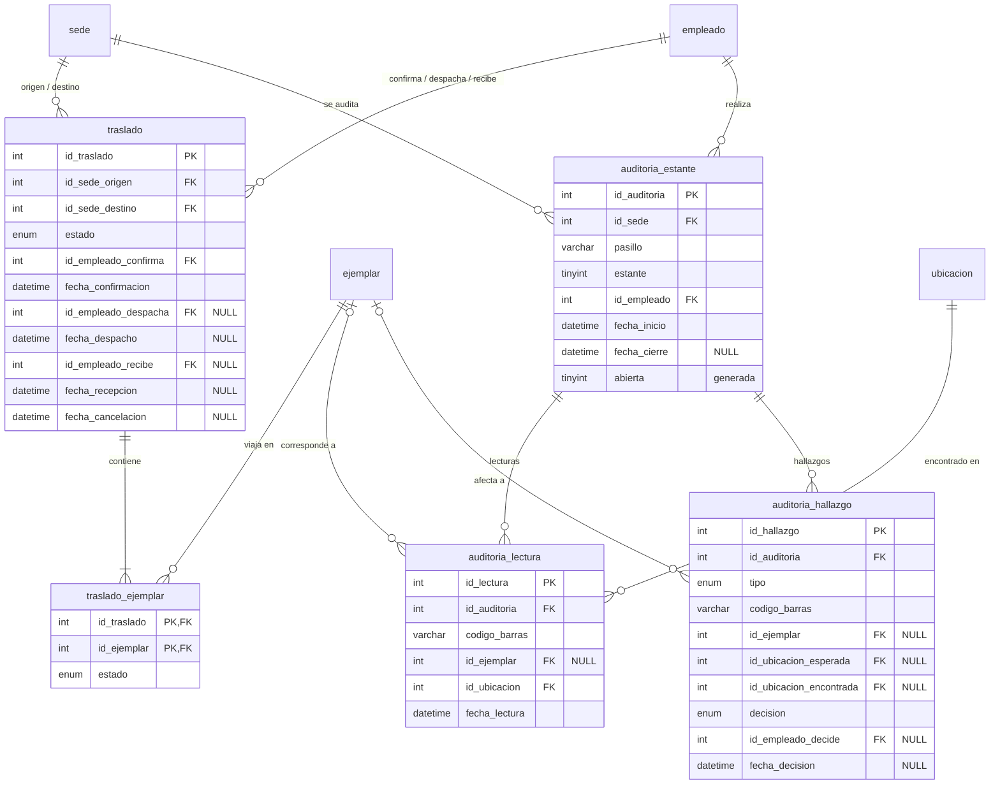
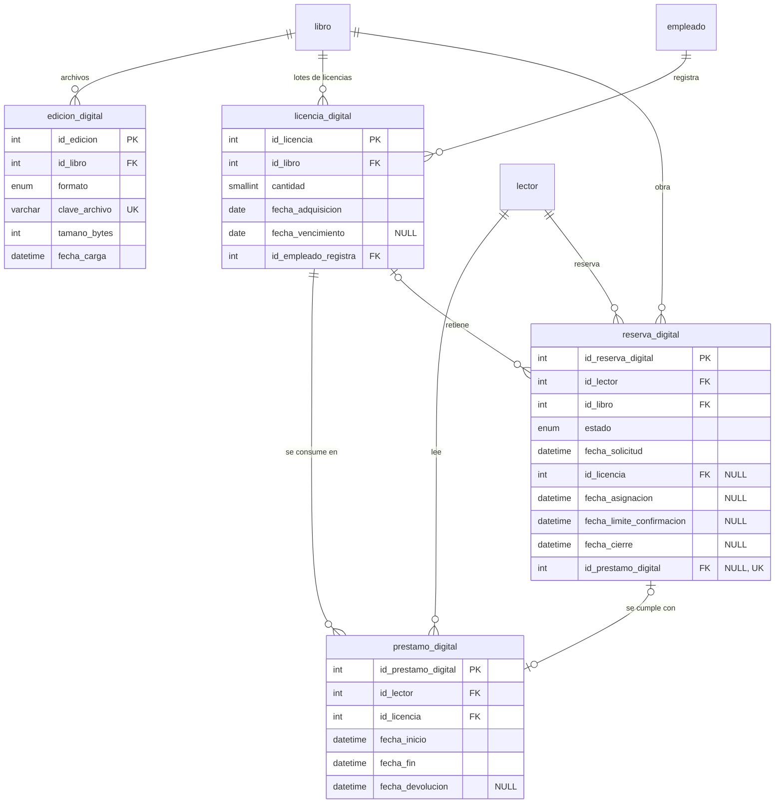
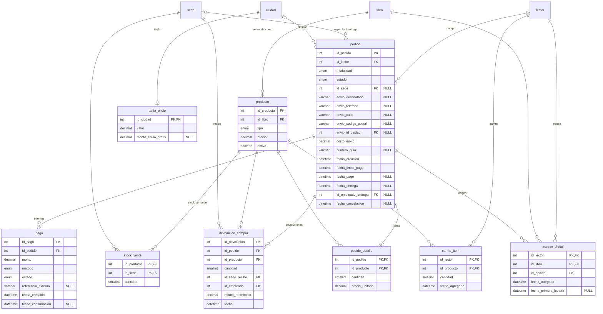

# Modelo de datos — bibliotecaNext

> Derivado de [reglas-de-negocio.md](reglas-de-negocio.md). Cada tabla indica de qué reglas sale.
> Convenciones: C-01 a C-05. Se construye por bloques; los tipos son los que tendrá `db/schema.sql` (MySQL 8).

## Bloque 1 — Catálogo y ubicación

### De dónde sale cada tabla

| Tabla | Reglas | Notas de diseño |
|---|---|---|
| `pais` | C-03 | Solo para la nacionalidad del autor. |
| `ciudad` | C-03, RN-42 | `UNIQUE(nombre, departamento)`: hay municipios con el mismo nombre en departamentos distintos. |
| `editorial` | C-02 | Catálogo editable. |
| `autor`, `autor_libro` | Caso BD2 | N:M. `id_pais` admite NULL: se puede no conocer la nacionalidad. |
| `clasificacion_edad` | RN-46 | `edad_minima` es lo que permite **calcular** si un lector puede acceder a un título. |
| `seccion` | RN-18 | De toda la red; el color es de la sección. `color_hex` con `CHECK` de formato `#RRGGBB`. |
| `genero` | RN-19 | `id_seccion NOT NULL`: cada género pertenece a una sola sección; así se sabe dónde va un libro. |
| `libro` | RN-19, RN-46 | `id_genero_principal` decide sección y color. `isbn` único. |
| `libro_genero` | RN-19 | Solo géneros **secundarios**. Que no repita el principal no se puede expresar con un `CHECK` (involucra otra tabla): se valida en la capa de lógica. |
| `sede` | D-01 | Antes `Biblioteca` en BD2 (C-05). |
| `ubicacion` | RN-17, RN-18 | Una fila = un nivel de un estante. `UNIQUE(id_sede, pasillo, estante, nivel)`. `UNIQUE(id_ubicacion, id_sede)` para la FK compuesta de `ejemplar`. |
| `ejemplar` | RN-06, RN-13, RN-20, RN-22, RN-23 | Ver restricciones abajo. |

### Restricciones de `ejemplar`

1. **La ubicación debe ser de la misma sede que el ejemplar.** Se garantiza con una FK compuesta:
   `FOREIGN KEY (id_ubicacion, id_sede) REFERENCES ubicacion (id_ubicacion, id_sede)`.
   Si `id_ubicacion` es NULL, la FK no se evalúa (por ubicar o en tránsito).
2. **Coherencia entre estado y ubicación** (RN-20, RN-22):
   - `por_ubicar` y `en_transito` → `id_ubicacion IS NULL`.
   - `disponible` → `id_ubicacion IS NOT NULL`.
   - Se expresa con `CHECK`. Limitación de MySQL (verificada en 8.4.11): una columna usada en un `CHECK` no puede
     tener acciones `ON DELETE/UPDATE` en su FK (`ERROR 3823 ... needed in a foreign key constraint ... referential
     action`). Esa FK queda sin acciones, que es lo que queremos: no se borra un estante con libros.
3. `estado` es ENUM (C-02) con los 8 valores de RN-22 y se actualiza en transacción (RN-23).
4. `id_sede` cambia al devolver en otra sede (RN-13) o al recibir un traslado (RN-16).

### Datos que **no** se guardan en este bloque

- **Fecha de la última auditoría de un estante** (RN-21): se calculará como `MAX(fecha)` de la tabla de auditorías
  (bloque de operación de sede), en vez de una columna que habría que mantener.
- **Disponibilidad por sede** (RN-08): `COUNT(*)` de ejemplares `disponible` agrupado por sede.

## Bloque 2 — Cuentas, lectores, préstamos físicos, reservas y multas

### De dónde sale cada tabla

| Tabla | Reglas | Notas de diseño |
|---|---|---|
| `configuracion` | C-04, valores iniciales, RN-14 | **Una sola fila** con columnas tipadas (`CHECK (id = 1)`), en vez de clave-valor: cada valor tiene su tipo y no se puede escribir mal el nombre. |
| `tipo_lector` | RN-02, RN-12, RN-26, RN-45 | Todos los límites por tipo de lector. |
| `cuenta` | RN-01, RN-31 | Sin columna de estado: se deduce de `fecha_verificacion`, `lector.fecha_validacion` y `fecha_desactivacion` (RN-01). |
| `token_cuenta` | RN-32 | Se guarda el **hash** del token, no el token: si alguien lee la BD, no puede usar los enlaces. `tipo`: `verificar_correo`, `recuperar_contrasena`. Un solo uso (`usado_en`) y vencimiento (`expira_en`). |
| `lector` | D-03, RN-02, RN-46 | Documento y validación quedan NULL hasta la validación en mostrador. `UNIQUE(tipo_documento, numero_documento)`. El carné de BD2 desaparece: lo identifica la cuenta y, tras validar, el documento. |
| `empleado` | RN-33, RN-34 | `rol` ENUM: `bibliotecario`, `coordinador`, `admin_red`. `CHECK`: `admin_red` ⇔ `id_sede IS NULL`. `activo` reemplaza a `EstadoEmpleado` de BD2. |
| `prestamo_fisico` | RN-02 a RN-05, RN-13, RN-34 | Estado **calculado**: devuelto / vencido / activo según las fechas. `renovaciones` como contador (RN-04); la fecha de vencimiento se corre al renovar. |
| `multa` | RN-05, RN-06 | `tipo`: `retraso`, `reposicion`. `UNIQUE(id_prestamo, tipo)`: un préstamo no genera dos multas del mismo tipo. `estado`: `pendiente`, `pagada`, `anulada`. |
| `reserva_fisica` | RN-07 a RN-12 | La cola es `ORDER BY fecha_solicitud, id_reserva`. `id_prestamo` enlaza la reserva cumplida con el préstamo que la cumplió. |

### Restricciones que protege la base de datos

1. **Un ejemplar no puede tener dos préstamos abiertos.** Columna generada
   `ejemplar_abierto AS (IF(fecha_devolucion IS NULL, id_ejemplar, NULL))` con `UNIQUE`.
   MySQL permite varios NULL en un índice único, así que solo choca entre préstamos abiertos.
   Es una **segunda barrera**, además del candado del estado del ejemplar (RN-23).
2. **Un lector no puede tener dos reservas vivas de la misma obra.** El mismo truco:
   columna generada con `id_libro` cuando el estado es `activa` o `asignada`, y `UNIQUE(id_lector, esa columna)`.
3. **Coherencia dentro de la fila** con `CHECK`:
   - préstamo: `fecha_devolucion`, `id_sede_devolucion` e `id_empleado_recibe` son todos NULL o todos no NULL;
     `fecha_vencimiento >= DATE(fecha_prestamo)`; `renovaciones >= 0`.
   - reserva: `asignada` ⇒ `id_ejemplar` y `fecha_limite_recogida` no NULL; `cumplida` ⇒ `id_prestamo` no NULL.
   - multa: `pagada` ⇔ `fecha_pago IS NOT NULL`; `monto > 0`.
4. **Lo que no puede proteger la BD** (involucra otras tablas o reglas con valores de configuración): límites del tipo
   de lector, bloqueo (RN-03, RN-43), edad (RN-46), renovación sin reservas (RN-04). Se validan en `lib/actions`, dentro
   de la transacción.
5. **Ejemplar asignado a una reserva de la misma obra y sede**: no se usa FK compuesta hacia `ejemplar` porque el ejemplar
   cambia de sede (colección flotante, RN-13) y la FK impediría actualizarlo mientras exista la reserva. Una FK compuesta
   solo conviene cuando las columnas referenciadas no cambian. Se valida en `lib/actions`.
6. `lector.tipo_documento`: ENUM `CC`, `TI`, `CE`, `PASAPORTE` (supuesto; ampliar si hace falta).

### Datos que no se guardan en este bloque

- **Estado del préstamo** (activo, vencido, devuelto): se deduce de las fechas (decisión heredada de BD2).
- **Bloqueo del lector** (RN-03): hay multas `pendiente` o préstamos abiertos con `fecha_vencimiento` pasada.
- **Edad del lector** (RN-46): `TIMESTAMPDIFF(YEAR, fecha_nacimiento, CURDATE())`.
- **Posición en la cola** de una reserva: se cuenta, no se guarda.

### Decisiones tomadas al derivar el bloque

- Estado de la cuenta deducido de fechas, sin ENUM → RN-01 actualizada.
- Vencimiento perezoso de reservas y pedidos → RN-48.
- Declaración de ejemplar perdido por un empleado, desde una lista calculada → RN-49.

## Bloque 3 — Operación de sede: traslados y auditorías

### De dónde sale cada tabla

| Tabla | Reglas | Notas de diseño |
|---|---|---|
| `traslado` | RN-14 a RN-16, RN-50 | Cabecera del lote. `estado`: `pendiente`, `en_transito`, `recibido`, `cancelado`. `CHECK (id_sede_origen <> id_sede_destino)` y un `CHECK` que fija qué fechas exige cada estado (solo se cancela antes del despacho). `fecha_cancelacion` agregada al escribir el SQL: la cancelación también es un hecho con fecha. |
| `traslado_ejemplar` | RN-51, RN-52 | Detalle. `estado`: `incluido`, `cancelado` (no estaba disponible al despachar). |
| `auditoria_estante` | RN-21, RN-53 | Un estante = `(id_sede, pasillo, estante)`, todos sus niveles. En curso ⇔ `fecha_cierre IS NULL` (deducido, sin ENUM). Columna generada `abierta` + `UNIQUE`: una sola auditoría abierta por estante (agregado al escribir el SQL). |
| `auditoria_lectura` | RN-53 | Guarda el **código leído** aunque no exista (`id_ejemplar` NULL). `UNIQUE(id_auditoria, codigo_barras)`: leer dos veces el mismo código no duplica. `id_ubicacion` = nivel donde se encontró. |
| `auditoria_hallazgo` | RN-53 | `tipo`: `faltante`, `mal_ubicado`, `estado_incoherente`, `desconocido`. `decision`: `pendiente`, `aplicada`, `descartada`. |

### Conceptos del bloque

- **Cabecera/detalle** (`traslado` + `traslado_ejemplar`): el mismo patrón que tendrán los pedidos. La cabecera guarda lo
  común al envío; el detalle, lo de cada ítem.
- **Congelar un cálculo al cerrar**: los hallazgos se podrían recalcular siempre, pero los ejemplares se siguen moviendo
  y el resultado de hoy no sería el de la auditoría. Al cerrarla, el cálculo se guarda como **hecho histórico**.
  Es la misma razón por la que el pedido guarda el precio del momento (RN-39).
- **Lo que no protege la BD**: que un ejemplar no esté en dos traslados abiertos a la vez (el estado vive en la
  cabecera, otra tabla). Lo cubren el candado de RN-51 y la validación en `lib/actions`.

### Fuera de alcance (anotado)

- Recepción parcial de un lote (llega la caja con un libro menos): se detectaría en una auditoría posterior.

## Bloque 4 — Préstamo digital

### De dónde sale cada tabla

| Tabla | Reglas | Notas de diseño |
|---|---|---|
| `edicion_digital` | RN-29, RN-54 | `UNIQUE(id_libro, formato)`. `clave_archivo` es el nombre del archivo en el almacenamiento privado (fuera de `public/`), **nunca una URL pública**; la ruta de lectura verifica el acceso y sirve el archivo. |
| `licencia_digital` | RN-25, RN-54 | Un lote. `CHECK (cantidad > 0)` y `fecha_vencimiento > fecha_adquisicion`. Es del título, no del formato: con la misma licencia se lee cualquier edición. |
| `prestamo_digital` | RN-26, RN-27, RN-44, RN-55 | Vigente ⇔ `fecha_devolucion IS NULL AND fecha_fin > NOW()` (**calculado**, vence solo). `fecha_fin` ya viene recortada por RN-44 al crear. `CHECK (fecha_fin > fecha_inicio)`. |
| `reserva_digital` | RN-28, RN-45, RN-56 | Misma forma que `reserva_fisica`, sin sede. Al asignarse retiene un lote (`id_licencia`). Columna generada + `UNIQUE` para una sola reserva viva por lector y obra. `CHECK`: `asignada` ⇒ `id_licencia` y `fecha_limite_confirmacion` no NULL; `cumplida` ⇒ `id_prestamo_digital` no NULL. |

### Concurrencia: dos patrones distintos

| Caso | Estado | Patrón |
|---|---|---|
| Ejemplar físico (RN-23) | Guardado en una fila por copia | `UPDATE ... WHERE estado = 'disponible'` y revisar filas afectadas |
| Licencia digital (RN-56) | Calculado (resta con fechas) | `SELECT ... FROM licencia_digital WHERE id_libro = ? FOR UPDATE`, contar en uso, insertar y `COMMIT` |

No se guarda un contador `en_uso` en la licencia: los préstamos vencen solos por fecha (RN-27) y nadie decrementaría
el contador en ese instante.

### Lo que valida la capa de lógica

- Un lector no tiene dos préstamos digitales vigentes del mismo título (depende de la fecha actual; no se puede
  expresar con `UNIQUE`).
- Máximo de préstamos digitales y de reservas digitales del tipo de lector (RN-26, RN-45), bloqueo (RN-43), edad (RN-46).

### Fuera de alcance (anotado)

- Guardar el **progreso de lectura** (página actual) para retomar en otro dispositivo: sería una tabla
  `progreso_lectura (id_lector, id_edicion, posicion, fecha)`. Buena mejora futura.

## Bloque 5 — Compras

### De dónde sale cada tabla

| Tabla | Reglas | Notas de diseño |
|---|---|---|
| `producto` | D-05 | Lo que se vende: un título en formato `fisico` o `digital`. `UNIQUE(id_libro, tipo)`. Precio **actual**; el histórico queda congelado en cada pedido. Que un digital tenga `edicion_digital` se valida en lógica. |
| `stock_venta` | RN-36, RN-37 | `CHECK (cantidad >= 0)`. Candado: `UPDATE ... SET cantidad = cantidad - ? WHERE ... AND cantidad >= ?`. Una devolución en una sede sin fila de stock la crea (`INSERT ... ON DUPLICATE KEY UPDATE`). |
| `tarifa_envio` | RN-42 | Una por ciudad; sin fila = no se envía a esa ciudad. |
| `carrito_item` | RN-57 | `CHECK (cantidad > 0)`. No aparta stock. |
| `pedido` | RN-37, RN-38, RN-40, RN-58 | `modalidad`: `recoger`, `envio`, `solo_digital`. `estado` con los valores de RN-40. Campos `envio_*` = **copia congelada** de la dirección. `CHECK` por modalidad: `recoger` ⇒ `id_sede` no NULL y `envio_*` NULL; `envio` ⇒ `id_sede` y `envio_*` no NULL; `solo_digital` ⇒ `id_sede` NULL y `costo_envio = 0`. |
| `pedido_detalle` | RN-39 | `precio_unitario` congelado. `CHECK (cantidad > 0)`. Que un ítem digital tenga cantidad 1 se valida en lógica. |
| `pago` | D-07, RN-59 | `metodo`: `simulado` (luego se agrega la pasarela). `estado`: `pendiente`, `pagado`, `fallido`, `reembolsado`. Columna generada + `UNIQUE` para un solo `pagado` por pedido. |
| `devolucion_compra` | RN-41, RN-60 | Una fila por ítem devuelto. `CHECK (cantidad > 0 AND monto_reembolso >= 0)`. Que no se devuelva más de lo comprado (suma de devoluciones ≤ cantidad del detalle) se valida en lógica. |
| `acceso_digital` | RN-30, RN-41, RN-61 | La PK `(id_lector, id_libro)` impide comprar dos veces. `fecha_primera_lectura` define "abierto". |

### Datos que no se guardan en este bloque

- **Subtotal y total del pedido**: `SUM(cantidad * precio_unitario)` del detalle + `costo_envio` (ambos congelados).
- **Pedido vencido por falta de pago**: se detecta con `fecha_limite_pago < NOW()` y se procesa con vencimiento perezoso
  (RN-48), que pasa el estado a `vencido` y devuelve el stock.
