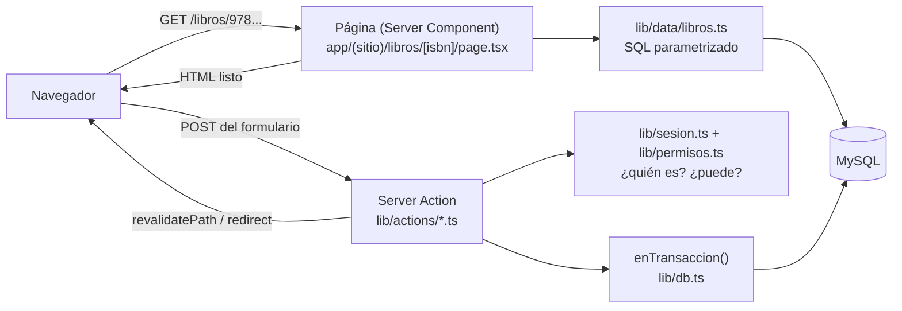

# Guía para exponer — bibliotecaNext (Programación Web)

> 10–15 minutos. El peso está en **cómo funciona, con qué está hecho y qué falta**. La demo es corta (≈ 3 min) y
> solo ilustra lo que ya explicaste. Datos de apoyo en `04-ficha-tecnica.md`; preguntas en `03-preguntas-posibles.md`.

## Guion por bloques

| # | Bloque | Minutos | Idea central |
|---|---|---|---|
| 1 | Qué es | 1 | Una web para una red de bibliotecas |
| 2 | Recursos | 2–3 | Next.js + React + TypeScript + Tailwind + MySQL, sin ORM |
| 3 | Cómo funciona | 3–4 | El servidor arma el HTML; los formularios llaman funciones del servidor |
| 4 | Demo rápida | 3 | Un solo recorrido |
| 5 | Seguridad web | 1–2 | Cookies, SQL parametrizado, permisos en el servidor, CSP |
| 6 | Pendiente | 2 | Lo que falta para dejarlo completo |
| 7 | Cierre | 1 | Qué aprendí |

---

### 1. Qué es (1 min)

> "bibliotecaNext es una aplicación web para una red de bibliotecas con tres sedes. Un lector busca un libro, ve en
> qué sede y en qué estante está, lo reserva o lo lee en línea si es digital. Los empleados prestan, reciben
> devoluciones, cobran multas y ven indicadores. Hay cinco tipos de usuario: visitante, lector, bibliotecario,
> coordinador y administrador de red."

Dato para mencionar: antes de programar escribí las reglas del negocio (95 reglas `RN-xx`) y el modelo de datos;
el código cita la regla que aplica.

### 2. Recursos: con qué está hecho (2–3 min)

| Pieza | Qué decir |
|---|---|
| **Next.js 16 (App Router)** | El framework: cada carpeta de `app/` es una ruta. Hace el frontend y el backend en el mismo proyecto |
| **React 19** | Los componentes de la interfaz |
| **TypeScript** | JavaScript con tipos: errores detectados antes de ejecutar |
| **Tailwind CSS 4 + shadcn/ui** | Estilos con clases utilitarias; componentes accesibles (Radix) que copié al proyecto y adapté |
| **MySQL 8.4 en Docker** | Base de datos relacional, 51 tablas; Docker la levanta igual en cualquier equipo |
| **mysql2, SQL a mano, sin ORM** | Quería entender el SQL que se ejecuta, no esconderlo |
| **foliate-js y pdf.js** | Para leer EPUB y PDF dentro del navegador |
| **Git + GitHub, pnpm, ESLint** | Control de versiones (trabajo en dos equipos), paquetes y revisión de código |

Comparación con lo visto en clase / el curso (Pages Router):

| Antes (Pages Router) | Ahora (App Router) |
|---|---|
| `pages/libros/[isbn].tsx` | `app/(sitio)/libros/[isbn]/page.tsx` |
| `getServerSideProps` para traer datos | El componente es `async` y consulta directo en el servidor |
| `pages/api/*.ts` para recibir formularios | **Server Actions**: una función `"use server"` que el `<form action>` llama |
| `_app.tsx` | `layout.tsx` (anidables por carpeta) |

### 3. Cómo funciona (3–4 min)

Muestra este diagrama (se ve en VS Code con vista previa de Markdown o en GitHub):

Qué contar, en este orden:

1. **Leer** (GET): el navegador pide una página. La página es un **Server Component**: corre en el servidor, consulta
   la BD a través de `lib/data/` y devuelve **HTML ya armado**. Ese código nunca llega al navegador.
2. **Escribir** (POST): un formulario como "Prestar" llama a una **Server Action**. La acción revisa la sesión y el
   permiso, valida los datos, aplica las reglas y hace los cambios en **una transacción**. Luego refresca la página.
3. **Interactividad solo donde hace falta**: el buscador del catálogo es un **Client Component**: espera 300 ms a
   que dejes de escribir y cambia la URL (`?q=`); la búsqueda la sigue haciendo el servidor. **Sin JavaScript también
   funciona** (es un formulario GET normal): eso se llama mejora progresiva.
4. **Capas**: presentación (`app/`) → lógica (`lib/actions/`) → datos (`lib/data/`) → pool (`lib/db.ts`).
   Un componente nunca escribe SQL.

### 4. Demo rápida (≈ 3 min, un solo recorrido)

Una frase por pantalla; no muestres código durante la demo.

| Paso | Pantalla | Qué decir |
|---|---|---|
| 1 | `/` — escribe "garcía" en el buscador | "La URL cambia sola y el servidor filtra. Hay paginación." |
| 2 | Abre *Cien años de soledad* | "Disponibilidad por sede y estante, reseñas de lectores." |
| 3 | Botón de tema (sol/luna) | "Tres temas; el tema se guarda en una cookie para no parpadear al cargar." |
| 4 | `/login` como `ana.ruiz@example.com` | "La sesión es una cookie `httpOnly`; en la BD guardo solo su hash." |
| 5 | Mi cuenta → Digitales → *El principito* → Leer | "Visor EPUB; el archivo no está en `public/`: solo se entrega si tengo el préstamo." |
| 6 | Salir; entra como `jorge.perez@example.com` (coordinador, Sede Norte) | "El panel muestra solo las secciones de su rol." |
| 7 | Mostrador → Nuevo préstamo: CC `1000000001`, código `BN-0015` (*Ficciones*) | "Todo el préstamo va en una transacción: se bloquean el ejemplar y el lector para que dos empleados no presten lo mismo." |

Si sobra tiempo: probar el mismo préstamo con Andrés (CC `1000000004`, tiene una multa pendiente) para mostrar que la
regla lo rechaza con un mensaje claro.

> Datos tomados de `db/init/02_seed.sql` y de la BD actual (BN-0015 disponible en Sede Norte; Ana tiene 1 préstamo
> de 3 posibles). **Haz el recorrido completo en el ensayo**: si la BD cambió, reconstrúyela antes.

### 5. Seguridad web (1–2 min)

Cinco frases:

1. **SQL parametrizado** siempre (`pool.execute(sql, [params])`): no hay inyección SQL.
2. **Cookie de sesión** `httpOnly` (el JavaScript no la lee) y `sameSite=lax` (no viaja en POST desde otro sitio);
   en la BD solo el SHA-256 del token.
3. **Contraseñas con scrypt** y límite de intentos por correo y por IP.
4. **Permisos verificados en el servidor** en cada página y cada acción, no solo ocultando botones.
5. **CSP con nonce** en el visor: un EPUB es HTML y podría traer JavaScript; la política lo bloquea (`proxy.ts`).

### 6. Pendiente para dejarlo completo (2 min)

| Pendiente | En una línea |
|---|---|
| Compras y pasarela real | Carrito y pedidos (las tablas existen); el pago hoy es simulado con un botón; falta recibir la notificación firmada del proveedor |
| Administración de la red | Crear empleados, libros, tipos de lector y configuración desde el panel |
| Traslados y auditorías | Mover ejemplares entre sedes y revisar estantes; hoy solo se sugieren |
| Subir libros digitales | Hoy los archivos se generan con un script |
| Foro por libro | Falta definir sus reglas |
| Calidad | Pruebas automáticas, Lighthouse, CSP en todo el sitio |
| Despliegue | Correo real, HTTPS y un servidor; hoy corre en local |

> "La base está: el modelo de datos ya contempla compras, traslados y auditorías. Lo que falta es construir sus
> pantallas y acciones con el mismo patrón."

### 7. Cierre (1 min)

Elige dos:

- Entender la diferencia entre lo que corre en el servidor y en el navegador.
- Escribir las reglas antes del código ahorra rehacer pantallas.
- Las transacciones importan en la web: dos personas pueden pulsar el mismo botón a la vez.
- La seguridad se decide en el servidor; el frontend solo ayuda.

---

## Checklist antes de exponer

- [ ] `docker compose ps` → `biblioteca-mysql` en `healthy` (si no: `docker compose up -d --wait`)
- [ ] `pnpm db:claves-dev` (si se reconstruyó la BD) y `pnpm archivos:muestra` (si faltan los libros digitales)
- [ ] `pnpm dev` y abrir `http://localhost:3000`
- [ ] Pestañas listas: catálogo, `/login`, VS Code con este archivo y `04-ficha-tecnica.md`
- [ ] Contraseña de desarrollo a mano (la de `DEV_PASSWORD` en tu `.env`; no la muestres en pantalla)
- [ ] Zoom del navegador al 125 % para el proyector
- [ ] Plan B: capturas de los 7 pasos de la demo por si falla la red o la BD
- [ ] Ensayo cronometrado una vez
